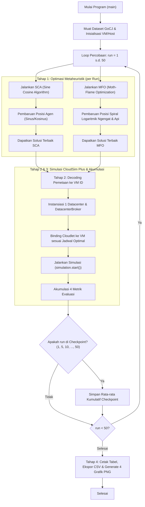
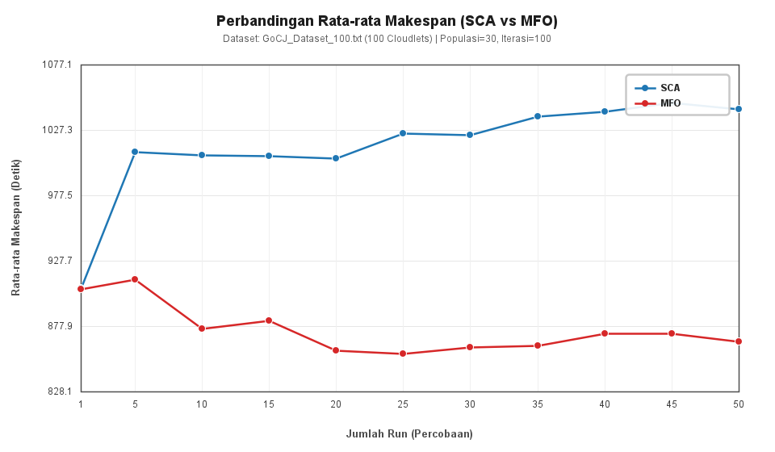
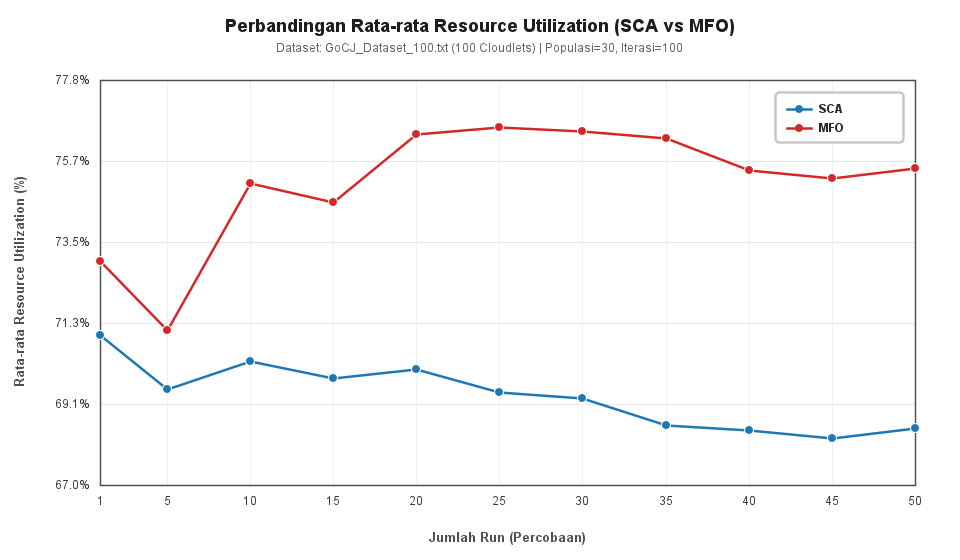
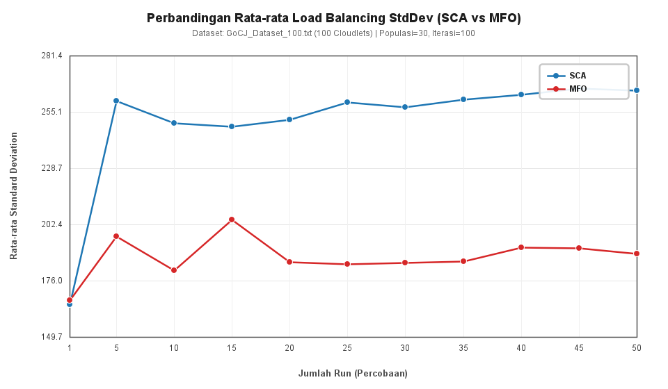
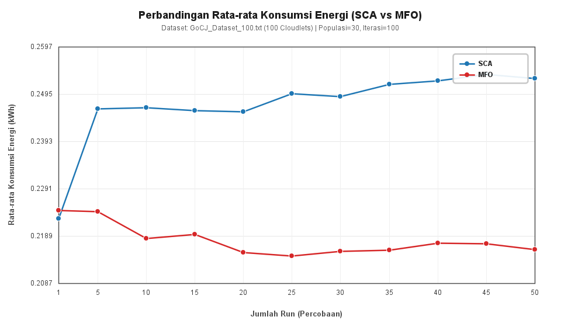

# Penjadwalan Tugas Komputasi Awan Berbasis Metaheuristik (SCA vs MFO) pada CloudSim Plus

Proyek ini merupakan implementasi dan analisis komparasi penjadwalan tugas (*task scheduling*) pada lingkungan komputasi awan (*cloud computing*) menggunakan dua algoritma metaheuristik modern: **Sine Cosine Algorithm (SCA)** dan **Moth-Flame Optimization (MFO)**. Simulasi dieksekusi secara realistis menggunakan framework **CloudSim Plus v7.3.0** dengan dataset benchmark **Google Cloud Jobs (GoCJ)**.

---

## Anggota Kelompok

Proyek ini disusun untuk memenuhi tugas mata kuliah **Strategi Optimasi Komputasi Awan (SOKA)** - Institut Teknologi Sepuluh Nopember (ITS).

| No | Nama Lengkap | NRP |
|:--:|:---|:---:|
| 1 | Putu Yudi Nandanjaya Wiraguna | 5027241080 |
| 2 | Danuja Prasasta Bastu | 5027241037 |
| 3 | Muhammad Huda Rabbani | 5027241098 |
| 4 | I Gede Bagus Saka Sinatrya | 5027241088 |
| 5 | Raynard Carlent | 5027241109 |

---

## Latar Belakang & Masalah

Penjadwalan tugas (*cloud task scheduling*) merupakan masalah optimasi kombinatorial berstatus **NP-hard**. Pada lingkungan komputasi awan heterogen, setiap *Virtual Machine* (VM) memiliki kapasitas komputasi (MIPS) yang berbeda-beda, dan setiap *Cloudlet* (tugas) memiliki panjang instruksi (*length/MI*) yang bervariasi.

Tujuan utama dari optimasi penjadwalan ini adalah:
1. **Meminimalkan Makespan**: Mempercepat waktu penyelesaian akhir dari seluruh tugas pada VM yang paling lambat.
2. **Memaksimalkan Utilisasi Sumber Daya (*Resource Utilization*)**: Memastikan seluruh VM bekerja optimal tanpa ada yang *idle*.
3. **Pemerataan Beban (*Load Balancing*)**: Mengurangi deviasi standar beban kerja di antara seluruh VM agar tidak terjadi *bottleneck*.
4. **Efisiensi Energi (*Energy Consumption*)**: Mengurangi konsumsi daya listrik (kWh) pada datacenter fisik.

---

## Model Simulasi & Spesifikasi Infrastruktur Cloud

Simulasi dibangun menggunakan framework **CloudSim Plus** dengan hierarki infrastruktur sebagai berikut:

### 1. Datacenter & Physical Hosts
- **Jumlah Datacenter:** **1 Datacenter** (`DatacenterSimple`) yang mengelola seluruh infrastruktur fisik dan komputasi awan.
- **Jumlah Host Fisik:** **4 Host** di dalam Datacenter tersebut.
- **Processing Elements (PE):** 2 Core per Host (masing-masing 10.000 MIPS, total 20.000 MIPS per Host).
- **RAM Fisik:** 16.384 MB (16 GB) per Host.
- **Storage Fisik:** 1.000.000 MB (1 TB) per Host.
- **Bandwidth Jaringan:** 10.000 Mbps.
- **VM Scheduler:** `VmSchedulerTimeShared` (pembagian waktu CPU host antar VM).
- **Model Konsumsi Daya Listrik:**
  - Daya Maksimal ($P_{max}$): 250 Watt per Host.
  - Daya Saat Menganggur ($P_{idle}$): $60\% \times P_{max} = 150\text{ Watt}$.

### 2. Virtual Machines (Heterogen)
Terdapat **8 VM** yang berjalan di dalam Datacenter dengan konfigurasi heterogen untuk merepresentasikan variasi mesin di lingkungan komputasi awan nyata:

| VM ID | MIPS (Kapasitas CPU) | RAM (MB) | Bandwidth (Mbps) | Storage (MB) | Cloudlet Scheduler |
|:-----:|:--------------------:|:--------:|:----------------:|:------------:|:-------------------|
| VM 0  | 1000                 | 1024     | 1000             | 10000        | Space-Shared       |
| VM 1  | 1000                 | 1024     | 1000             | 10000        | Space-Shared       |
| VM 2  | 2000                 | 1024     | 1000             | 10000        | Space-Shared       |
| VM 3  | 3000                 | 1024     | 1000             | 10000        | Space-Shared       |
| VM 4  | 2500                 | 1024     | 1000             | 10000        | Space-Shared       |
| VM 5  | 4000                 | 1024     | 1000             | 10000        | Space-Shared       |
| VM 6  | 4000                 | 1024     | 1000             | 10000        | Space-Shared       |
| VM 7  | 4000                 | 1024     | 1000             | 10000        | Space-Shared       |

### 3. Dataset Tugas (Cloudlets)
Dataset yang digunakan adalah benchmark standar **GoCJ (Google Cloud Jobs)** yang disimpan di `src/main/resources/`:
- Tersedia 23 variasi ukuran dataset: mulai dari `GoCJ_Dataset_100.txt` hingga `GoCJ_Dataset_5000.txt` (100, 150, 200, 250, ..., 1000, 2000, 3000, 4000, 5000 tugas).
- Setiap baris mewakili panjang instruksi tugas dalam satuan MI (*Million Instructions*).

---

## Alur Kerja Sistem (System Workflow)

Alur eksekusi program dirancang modular dengan menjalankan eksperimen **multi-run (1 s.d. 50 runs)** untuk menjamin validitas statistik, mengevaluasi simulasi diskrit pada mesin CloudSim Plus, serta mengekspor tabel dan 4 grafik perbandingan secara otomatis:



### Tahapan Alur Kerja:
1. **Inisialisasi Data:** Program membaca dataset GoCJ dari `src/main/resources/` dan membuat daftar objek `CloudletSimple` serta daftar referensi `VmSimple`.
2. **Pencarian Optimasi (SCA & MFO) per Run:**
   - Agen/ngengat merepresentasikan solusi pemetaan tugas ke VM dalam ruang kontinu $[0, m - 1]$ (rentang ID VM $0$ hingga $7$, dengan $m = 8$).
   - Setiap posisi dievaluasi nilai *fitness*-nya berdasarkan Makespan estimasi.
   - Algoritma SCA dan MFO memperbarui posisi seluruh individu hingga mencapai `MAX_ITERATION` (100 iterasi).
3. **Decoding & Eksekusi Simulasi CloudSim Plus:**
   - Vektor posisi kontinu terbaik dibulatkan (*rounding*) menjadi indeks integer diskrit VM ($0$ sampai $7$).
   - Datacenter (1 buah), 4 Host fisik, dan Broker diinstansiasi dengan `new CloudSim(0.01)` dan `vmDestructionDelay = 10.0`.
   - Broker mengikat masing-masing tugas ke VM target (`broker.bindCloudletToVm`) dan menjalankan simulasi (`simulation.start()`).
4. **Akumulasi Multi-Run & Checkpoint:**
   - Siklus diulang sebanyak **50 kali** (`MAX_RUNS = 50`).
   - Pada titik checkpoint **`1, 5, 10, 15, 20, 25, 30, 35, 40, 45, 50`**, program menghitung rata-rata kumulatif dari 4 metrik evaluasi untuk melihat kestabilan statistik (*convergence of mean*).
5. **Output & Visualisasi Otomatis:** Program mencetak tabel perbandingan di konsol, mengekspor file `.csv`, dan menggambar 4 file grafik garis `.png` ke folder `output/`.

---

## Algoritma Metaheuristik yang Digunakan

### 1. Sine Cosine Algorithm (SCA)
Dikembangkan oleh Seyedali Mirjalili (2016), SCA memanfaatkan sifat matematis osilasi fungsi trigonometri sinus ($\sin$) dan kosinus ($\cos$) untuk melakukan eksplorasi (*exploration*) dan eksploitasi (*exploitation*) pada ruang pencarian solusi.

#### a. Persamaan Pembaruan Posisi Agen
Pada setiap iterasi $t$, posisi agen ke-$i$ pada dimensi ke-$d$ diperbarui menggunakan persamaan matematis:

$$
X_{i,d}^{t+1} = \begin{cases} 
X_{i,d}^t + r_1 \cdot \sin(r_2) \cdot \left| r_3 \cdot P_d^t - X_{i,d}^t \right|, & \text{jika } r_4 < 0.5 \\[12pt]
X_{i,d}^t + r_1 \cdot \cos(r_2) \cdot \left| r_3 \cdot P_d^t - X_{i,d}^t \right|, & \text{jika } r_4 \ge 0.5 
\end{cases}
$$

di mana $P_d^t$ adalah posisi terbaik (*best destination point*) pada dimensi $d$ yang telah ditemukan oleh populasi hingga iterasi $t$.

#### b. Persamaan Parameter Adaptif ($r_1$)
Untuk memastikan terjadinya transisi yang mulus dari tahap eksplorasi global ke tahap eksploitasi lokal, parameter $r_1$ diturunkan secara linear terhadap iterasi:

$$
r_1 = a - t \cdot \left(\frac{a}{T}\right)
$$

dengan nilai konstanta $a = 2$, $t$ adalah iterasi saat ini, dan $T$ adalah iterasi maksimum (`MAX_ITERATION = 100`).

#### c. Rincian Peran Parameter SCA
| Parameter | Nilai / Rentang | Peran & Pengaruh Matematis |
|:---:|:---:|:---|
| **$r_1$** | $2 \to 0$ (Linear) | **Menentukan radius area pencarian**: Mengarahkan perpindahan agen menuju ruang antara agen dan target tujuan ($r_1 \le 1$, eksploitasi) atau di luar target tujuan ($r_1 > 1$, eksplorasi). |
| **$r_2$** | $[0, 2\pi]$ | **Menentukan arah & jarak**: Menentukan seberapa jauh pergerakan agen harus menuju atau menjauhi posisi terbaik tujuan. |
| **$r_3$** | $[0, 2]$ | **Bobot stokastik target ($P_d^t$)**: Memberikan efek acak untuk memperkuat ($r_3 > 1$) atau mengurangi ($r_3 < 1$) pengaruh posisi target terbaik. |
| **$r_4$** | $[0, 1]$ | **Saklar transisi (*switching mechanism*)**: Mengontrol pergantian probabilistik antara penggunaan fungsi sinus ($r_4 < 0.5$) dan kosinus ($r_4 \ge 0.5$). |

---

### 2. Moth-Flame Optimization (MFO)
Dikembangkan oleh Seyedali Mirjalili (2015), MFO mengemulasikan mekanisme navigasi melintang (*transverse orientation*) ngengat (*moths*) di alam bebas yang mempertahankan sudut konstan terhadap sumber cahaya/api (*flames*).

#### a. Persamaan Pergerakan Spiral Logaritmik
Setiap ngengat memperbarui posisinya terhadap api (*flame*) target menggunakan model spiral logaritmik:

$$
M_{i,d}^{t+1} = D_i \cdot e^{b \cdot r} \cdot \cos(2\pi r) + F_{j,d}^t
$$

di mana:
- $D_i = \left| F_{j,d}^t - M_{i,d}^t \right|$ merepresentasikan jarak linier antara ngengat ke-$i$ dengan api ke-$j$.
- $b = 1$ adalah konstanta yang mendefinisikan bentuk spiral logaritmik.
- $r \in [a, 1]$ adalah bilangan acak yang menentukan kedekatan posisi berikutnya terhadap api ($r = -1$ adalah titik terdekat ke api, $r = 1$ adalah titik terjauh).
- $F_{j,d}^t$ adalah posisi api ke-$j$ pada dimensi ke-$d$.

#### b. Persamaan Penurunan Adaptif Parameter Spiral ($a$)
Parameter $a$ diturunkan secara linear dari $-1$ menuju $-2$ untuk mempercepat konvergensi di sekitar api:

$$
a = -1 + t \cdot \left(\frac{-1}{T}\right)
$$

#### c. Persamaan Pengurangan Jumlah Api Adaptif (*Adaptive Flame Reduction*)
Untuk menghindari konvergensi prematur (*stagnation*) pada optimum lokal dan menyeimbangkan eksplorasi dengan eksploitasi, jumlah api yang aktif dikurangi secara dinamis sepanjang iterasi:

$$
\text{FlameNo} = \text{round}\left(N - t \cdot \left(\frac{N - 1}{T}\right)\right)
$$

dengan $N$ adalah ukuran populasi awal (`POPULATION_SIZE = 30`), $t$ adalah iterasi saat ini, dan $T$ adalah iterasi maksimum (`MAX_ITERATION = 100`). Pada iterasi akhir, seluruh ngengat hanya memperbarui posisi terhadap api terbaik pertama.

---

## 4 Metrik Evaluasi Kinerja

Untuk membandingkan performa penjadwalan antara algoritma **SCA** dan **MFO**, digunakan 4 metrik evaluasi kuantitatif utama:

---

### 1. Makespan (Completion Time)

Makespan adalah waktu penyelesaian akhir dari seluruh rangkaian tugas, yaitu waktu eksekusi pada *Virtual Machine* yang paling lambat menyelesaikan pekerjaannya.

#### Formulasi Matematis:
$$
\text{Makespan} = \max_{j \in \{0, 1, \dots, m-1\}} \text{Load}(VM_j)
$$

di mana beban komputasi total pada mesin ke-$j$ ($\text{Load}(VM_j)$) dihitung dari penjumlahan waktu eksekusi setiap Cloudlet yang dialokasikan ke VM tersebut:

$$
\text{Load}(VM_j) = \sum_{c \in \mathcal{C}_j} \frac{\text{Length}_c}{\text{MIPS}_j}
$$

- $\mathcal{C}_j$: Himpunan seluruh Cloudlet yang dialokasikan pada $VM_j$.
- $\text{Length}_c$: Panjang instruksi Cloudlet $c$ dalam satuan *Million Instructions* (MI).
- $\text{MIPS}_j$: Kapasitas pemrosesan $VM_j$ dalam satuan *Million Instructions Per Second*.
- **Arah Optimasi:** **Minimalkan ($\downarrow$)**. Semakin kecil nilai Makespan, semakin cepat seluruh tugas terselesaikan.

---

### 2. Resource Utilization (RU)

Resource Utilization mengukur persentase efisiensi pemanfaatan rata-rata seluruh mesin terhadap Makespan total. Metrik ini menunjukkan seberapa baik kapasitas pemrosesan seluruh VM digunakan tanpa membiarkan mesin menganggur (*idle*).

#### Formulasi Matematis:
$$
\text{Utilization} = \left( \frac{\overline{\text{Load}}}{\text{Makespan}} \right) \times 100\%
$$

di mana $\overline{\text{Load}}$ merupakan rata-rata beban kerja di seluruh $m$ mesin virtual:

$$
\overline{\text{Load}} = \frac{1}{m} \sum_{j=0}^{m-1} \text{Load}(VM_j)
$$

- $m$: Jumlah total Virtual Machines yang aktif ($m = 8$).
- **Arah Optimasi:** **Maksimalkan ($\uparrow$)**. Semakin tinggi nilai persentase (mendekati $100\%$), semakin produktif seluruh VM bekerja secara bersamaan.

---

### 3. Load Balancing (Standard Deviation / $\sigma$)

Standard Deviation mengukur dispersi atau tingkat ketimpangan persebaran beban komputasi di antara seluruh Virtual Machines.

#### Formulasi Matematis:
$$
\sigma = \sqrt{\frac{1}{m} \sum_{j=0}^{m-1} \left( \text{Load}(VM_j) - \overline{\text{Load}} \right)^2}
$$

- Jika nilai $\sigma \approx 0$, beban kerja terdistribusi merata ke seluruh VM sesuai proporsi kemampuannya.
- Jika nilai $\sigma$ besar, terjadi ketimpangan (*imbalance*) di mana sebagian VM mengalami kelebihan beban (*overloaded*) sementara yang lain menganggur (*underloaded*).
- **Arah Optimasi:** **Minimalkan ($\downarrow$)**. Semakin kecil standar deviasi, pembagian beban kerja semakin seimbang dan stabil.

---

### 4. Konsumsi Energi Datacenter (Energy Consumption in kWh)

Menghitung estimasi total konsumsi energi listrik oleh seluruh Host fisik selama proses komputasi berlangsung, mengadopsi model daya linier berbasis utilisasi CPU.

#### Formulasi Konsumsi Daya Host Fisik:
$$
P_{\text{host}} = P_{\text{idle}} + \left( P_{\text{max}} - P_{\text{idle}} \right) \times \left( \frac{\text{Utilization}}{100} \right)
$$

#### Formulasi Total Konsumsi Energi:
$$
\text{Energy (kWh)} = \frac{N_{\text{host}} \times P_{\text{host}} \times \text{Makespan}}{3.600.000}
$$

- $N_{\text{host}} = 4$: Jumlah Host fisik aktif di Datacenter (`HOST_COUNT = 4`).
- $P_{\text{max}} = 250\text{ Watt}$: Konsumsi daya listrik pada beban penuh ($100\%$ CPU).
- $P_{\text{idle}} = 60\% \times P_{\text{max}} = 150\text{ Watt}$: Konsumsi daya listrik dasar saat menganggur (*idle*).
- Faktor pembagi $3.600.000$: Konversi dari satuan Joule (Watt $\times$ detik) menjadi kilowatt-hour (kWh).
- **Arah Optimasi:** **Minimalkan ($\downarrow$)**. Semakin kecil konsumsi energi, semakin ramah lingkungan dan hemat biaya operasional datacenter.

---

### Ringkasan 4 Metrik Evaluasi

| Metrik Evaluasi | Simbol / Formulasi Utama | Satuan | Arah Optimasi | Target Kinerja |
|:---|:---:|:---:|:---:|:---|
| **Makespan** | $\max_{j} \text{Load}(VM_j)$ | Detik ($s$) | $\downarrow$ Minimum | Waktu proses penyelesaian seluruh tugas secepat mungkin |
| **Resource Utilization** | $\left(\frac{\overline{\text{Load}}}{\text{Makespan}}\right) \times 100\%$ | Persen ($\%$) | $\uparrow$ Maksimum | Seluruh VM bekerja optimal tanpa ada yang *idle* |
| **Load Balancing** | $\sqrt{\frac{1}{m} \sum (\text{Load}_j - \overline{\text{Load}})^2}$ | Angka Riil | $\downarrow$ Minimum | Beban kerja terdistribusi merata ke seluruh VM |
| **Konsumsi Energi** | $\frac{N_{\text{host}} \times P_{\text{host}} \times \text{Makespan}}{3.600.000}$ | Kilowatt-hour ($\text{kWh}$) | $\downarrow$ Minimum | Penggunaan daya listrik seminimal mungkin |

---

## Source Code & Implementasi

Seluruh implementasi proyek ini terpusat pada file [SokaCloudSimRunner.java](src/main/java/org/example/SokaCloudSimRunner.java) dengan struktur modul yang sangat terorganisir:

### 1. Konstanta & Parameter Konfigurasi
Terletak pada bagian awal class `SokaCloudSimRunner`:
- `DATASET_FILE`: Menentukan nama file dataset yang akan diuji dari folder `resources` (default: `GoCJ_Dataset_100.txt`).
- `HOST_COUNT` (4): Jumlah Host fisik di Datacenter.
- `HOST_MAX_POWER_WATT` (250.0): Daya maksimum per host.
- `VM_COUNT` (8): Jumlah Virtual Machines heterogen.
- `POPULATION_SIZE` (30): Jumlah agen/ngengat dalam populasi metaheuristik ($N$).
- `MAX_ITERATION` (100): Jumlah iterasi maksimum algoritma ($T$).
- `MAX_RUNS` (50) & `CHECKPOINTS` (`{1, 5, 10, 15, 20, 25, 30, 35, 40, 45, 50}`): Pengaturan eksperimen multi-run untuk menghitung rata-rata kumulatif pada setiap kelipatan percobaan.
- `OUTPUT_DIR` (`"output"`): Folder penyimpanan otomatis file `.csv` dan 4 grafik `.png`.

### 2. Fungsi Utama (`main`)
- Mematikan log `INFO` internal CloudSim Plus (`Log.setLevel(Level.WARN)`) agar eksekusi 50 kali simulasi berjalan cepat dan ringkas.
- Menjalankan perulangan `1` s.d. `MAX_RUNS` yang masing-masing memanggil `runSCA(...)`, `runMFO(...)`, dan `runCloudSimWithMapping(...)`.
- Menghitung rata-rata kumulatif 4 metrik pada setiap checkpoint (`1, 5, 10, ..., 50`), mencetak tabel rekapitulasi ke konsol, serta memanggil `exportResultsAndCharts(...)`.

### 3. Pemuatan Dataset (`loadCloudletsFromDataset`)
- Menggunakan `ClassLoader.getResourceAsStream()` untuk membaca file dataset GoCJ dari `src/main/resources/`.
- Membaca baris demi baris, mengonversi nilai menjadi panjang instruksi tugas (`length`), dan membuat objek `CloudletSimple`.
- Mengatur ukuran file input/output sebesar 300 byte dan model utilisasi penuh (`UtilizationModelFull`).

### 4. Pembangun Infrastruktur Datacenter & VM
- `createDatacenter(CloudSim simulation)`:
  - Menginstansiasi **1 Datacenter** (`DatacenterSimple`).
  - Mengonfigurasi 4 Host (`HostSimple`), masing-masing dengan 2 PE (10.000 MIPS per PE), RAM 16 GB, Storage 1 TB, Bandwidth 10 Gbps, dan scheduler `VmSchedulerTimeShared`.
- `createVms()`:
  - Menginstansiasi 8 VM heterogen (`VmSimple`) dengan array MIPS: `{1000, 1000, 2000, 3000, 2500, 4000, 4000, 4000}`.
  - Setiap VM menggunakan scheduler `CloudletSchedulerSpaceShared`.

### 5. Algoritma Optimasi Metaheuristik
- `runSCA(List<Cloudlet> cloudlets, List<Vm> vms)`:
  - Menginisialisasi populasi agen berdimensi $D$ (sejumlah Cloudlets).
  - Melakukan looping hingga 100 iterasi.
  - Memperbarui parameter adaptif $r_1$, nilai stokastik $r_2, r_3, r_4$, serta posisi agen berbasis fungsi sinus dan kosinus.
  - Menyimpan posisi terbaik global (*globalBest*).
- `runMFO(List<Cloudlet> cloudlets, List<Vm> vms)`:
  - Menginisialisasi populasi ngengat dan daftar api (*flames*).
  - Mengurutkan fitness ngengat dan api.
  - Menghitung penurunan jumlah api secara adaptif (`flameNo`).
  - Memperbarui posisi ngengat berdasarkan rumus spiral logaritmik terhadap api target.

### 6. Decoding & Evaluasi Kebugaran (*Fitness*)
- `decodeToVmIndex(double continuousValue, int vmCount)`:
  - Mengonversi nilai float/double posisi agen menjadi integer indeks VM menggunakan `Math.round()`, dengan batas aman $[0, \text{vmCount} - 1]$.
- `evaluatePosition(double[] position, ...)`:
  - Menghitung akumulasi waktu eksekusi tugas pada masing-masing VM:
    $$ExecTime = \frac{\text{Cloudlet Length}}{\text{VM MIPS}}$$
  - Mengembalikan objek `MetricsResult` dengan Makespan sebagai nilai fitness utama.
- `computeMetricsFromLoads(double[] vmLoads)`:
  - Menghitung Makespan, rata-rata beban (*average load*), persentase utilisasi, standar deviasi (*load balancing*), dan estimasi konsumsi energi (kWh).

### 7. Eksekusi Simulasi CloudSim Plus (`runCloudSimWithMapping`)
- Membuat instansiasi `new CloudSim(0.01)` (resolusi waktu event `0.01` detik untuk presisi antar-event), `Datacenter`, dan `DatacenterBrokerSimple` dengan `broker.setVmDestructionDelay(10.0)` guna mencegah VM dihancurkan terlalu cepat saat pergantian antrean di `CloudletSchedulerSpaceShared`.
- Mendaftarkan daftar VM dan daftar Cloudlet ke Broker.
- Melakukan pemetaan definitif menggunakan `broker.bindCloudletToVm(cloudlet, vm)` berdasarkan jadwal terbaik hasil optimasi.
- Memulai simulasi dengan `simulation.start()`.
- Mengambil daftar tugas yang selesai dieksekusi (`broker.getCloudletFinishedList()`) dan menghitung 4 metrik evaluasi.

### 8. Ekspor Data & Generator Grafik (`exportResultsAndCharts`, `saveLineChart`)
- Menyimpan rekapitulasi seluruh checkpoint ke file CSV (`output/hasil_multi_run_50.csv`).
- Menggunakan `java.awt.Graphics2D` dan `ImageIO` bawaan JDK (tanpa dependensi eksternal) untuk menggambar dan menyimpan 4 file grafik garis beresolusi tinggi (`960 x 560` px) ke dalam folder `output/`.

### 9. Inner Classes (Struktur Data Pendukung)
- `Agent`: Representasi individu solusi yang menyimpan array posisi `double[] position` dan `double fitness`. Mengimplementasikan `Comparable<Agent>` untuk mempermudah sorting pada algoritma MFO.
- `OptimizationResult`: Kontainer yang menyimpan vektor posisi terbaik (`bestPosition`) dan kurva konvergensi per iterasi (`convergenceCurve`).
- `MetricsResult`: Kontainer untuk menyimpan 4 metrik evaluasi (makespan, utilization, stdDev, energyKwh).
- `CheckpointResult`: Kontainer penyimpan hasil rata-rata kumulatif SCA dan MFO pada setiap titik checkpoint (`1, 5, 10, ..., 50`).
- `SimulationOutput`: Kontainer penyimpan daftar tugas selesai dan objek `MetricsResult`.

---

## Struktur Direktori

```text
Metaheuristik-SCA-MFO/
├── .idea/                           # Konfigurasi IDE IntelliJ
├── output/                          # Hasil eksekusi otomatis (CSV & 4 Grafik PNG)
│   ├── 1_grafik_makespan.png
│   ├── 2_grafik_utilization.png
│   ├── 3_grafik_load_balancing.png
│   ├── 4_grafik_energi.png
│   └── hasil_multi_run_50.csv
├── src/
│   └── main/
│       ├── java/
│       │   └── org/
│       │       └── example/
│       │           └── SokaCloudSimRunner.java   # Source code utama (SCA, MFO, CloudSim Plus, Grafik)
│       └── resources/
│           ├── GoCJ_Dataset_100.txt              # Dataset benchmark 100 cloudlets
│           ├── GoCJ_Dataset_150.txt
│           ├── ...
│           └── GoCJ_Dataset_5000.txt             # Dataset benchmark 5000 cloudlets
├── pom.xml                                      # Konfigurasi Maven & dependensi CloudSim Plus
└── README.md                                    # Dokumentasi komprehensif proyek
```

---

## Panduan Menjalankan Proyek

### Prasyarat
- **Java Development Kit (JDK):** Versi 17 atau lebih baru (direkomendasikan JDK 17 atau JDK 21).
- **Apache Maven:** Versi 3.6+ (jika menjalankan melalui CLI).
- **IDE (Opsional):** IntelliJ IDEA, Eclipse, atau Visual Studio Code.

---

### Cara 1: Menggunakan Maven CLI (Terminal / PowerShell / Command Prompt)

1. Pastikan Anda berada pada direktori *root* proyek:
   ```bash
   cd Metaheuristik-SCA-MFO
   ```

2. Jalankan perintah kompilasi dan eksekusi:
   ```bash
   mvn compile exec:java "-Dexec.mainClass=org.example.SokaCloudSimRunner"
   ```

---

### Cara 2: Menggunakan IntelliJ IDEA

1. Buka folder proyek ini di **IntelliJ IDEA** (`File` -> `Open...`).
2. Tunggu proses sinkronisasi Maven selesai mengunduh dependensi `cloudsim-plus`.
3. Buka file `src/main/java/org/example/SokaCloudSimRunner.java`.
4. Klik tombol panah hijau **Run ▶** di sebelah method `public static void main(String[] args)` atau tekan shortcut **`Shift + F10`**.

---

### Cara 3: Menggunakan Visual Studio Code

1. Buka folder proyek di VS Code.
2. Pastikan ekstensi **Extension Pack for Java** telah terinstal.
3. Buka file `SokaCloudSimRunner.java` dan klik tombol **Run** yang muncul di atas method `main`.

---

## Konfigurasi Eksperimen

Anda dapat menyesuaikan parameter eksperimen dengan mengubah konstanta pada baris awal class `SokaCloudSimRunner.java`:

```java
// Pilih dataset dari folder src/main/resources/
private static final String DATASET_FILE = "GoCJ_Dataset_100.txt";

// Parameter Infrastruktur
private static final int HOST_COUNT = 4;
private static final double HOST_MAX_POWER_WATT = 250.0;
private static final int VM_COUNT = 8;

// Parameter Metaheuristik
private static final int POPULATION_SIZE = 30; // Ukuran Populasi (N)
private static final int MAX_ITERATION = 100;  // Iterasi Maksimum (T)

// Parameter Eksperimen Multi-Run & Output Grafik
private static final int MAX_RUNS = 50;
private static final int[] CHECKPOINTS = {1, 5, 10, 15, 20, 25, 30, 35, 40, 45, 50};
private static final String OUTPUT_DIR = "output";
```

---

## Justifikasi Parameter Metaheuristik (`N = 30`, `T = 100`)

Penetapan `POPULATION_SIZE = 30` ($N$) dan `MAX_ITERATION = 100` ($T$) didasarkan pada **standar literatur metaheuristik** serta **analisis sensitivitas parameter empiris** (*parameter sensitivity analysis*) pada dataset proyek ini untuk menyeimbangkan kualitas solusi (*Makespan*) dan biaya waktu komputasi ($O(N \cdot T \cdot D)$).

### 1. Justifikasi Berdasarkan Literatur
- **Ukuran Populasi ($N = 30$):** Merupakan nilai *baseline* standar yang direkomendasikan dan digunakan pada eksperimen benchmark di paper asli **Moth-Flame Optimization** (Mirjalili, 2015) serta **Sine Cosine Algorithm** (Mirjalili, 2016). Jumlah 30 agen/individu memberikan variasi stokastik yang memadai untuk menjaga keragaman solusi tanpa membebani memori maupun waktu eksekusi.
- **Iterasi Maksimum ($T = 100$):** Menjadi batas standar evaluasi konvergensi untuk melihat kecepatan algoritma mencapai titik stabil pada masalah penjadwalan berskala menengah hingga besar (100–5000 Cloudlets).

### 2. Justifikasi Berdasarkan Data Uji Sensitivitas
Pengujian empiris dilakukan pada dataset `GoCJ_Dataset_100.txt` (100 Cloudlets) dengan **10 kali pengulangan acak** per konfigurasi untuk memperoleh nilai rata-rata yang objektif:

#### a. Pengaruh Variasi Ukuran Populasi ($N$) dengan $T = 100$
| Ukuran Populasi ($N$) | Rata-rata Makespan SCA (s) | Waktu Komputasi SCA (ms) | Rata-rata Makespan MFO (s) | Waktu Komputasi MFO (ms) |
|:---:|:---:|:---:|:---:|:---:|
| **10** | 1206.60 s | 13.30 ms | 968.19 s | 9.30 ms |
| **20** | 1088.46 s | 21.50 ms | 872.16 s | 15.40 ms |
| **30** *(Dipilih)* | **1071.03 s** | **33.10 ms** | **873.70 s** | **22.20 ms** |
| **50** | 961.30 s | 63.00 ms | 837.64 s | 42.40 ms |
| **100** | 950.56 s | 123.20 ms | 822.18 s | 81.30 ms |

- **Analisis Data ($N$):**
  - Pada $N = 10$, populasi terlalu kecil sehingga eksplorasi ruang pencarian berdimensi 100 tidak memadai (Makespan SCA masih tinggi di $1206.60\text{ s}$ dan MFO $968.19\text{ s}$).
  - Pada $N = 30$, kualitas solusi membaik signifikan dibandingkan $N = 10$ dengan waktu eksekusi yang sangat ringan ($22.20\text{–}33.10\text{ ms}$).
  - Menaikkan populasi ke $N = 50$ atau $N = 100$ memang masih dapat menurunkan Makespan, namun waktu komputasi meningkat **$2\times$ hingga $3.7\times$ lipat** (sekitar $81.30\text{–}123.20\text{ ms}$ untuk 100 Cloudlets) yang berdampak signifikan saat dijalankan pada dataset besar hingga $5000$ Cloudlets.

#### b. Pengaruh Variasi Iterasi Maksimum ($T$) dengan $N = 30$
| Iterasi Maksimum ($T$) | Rata-rata Makespan SCA (s) | Waktu Komputasi SCA (ms) | Rata-rata Makespan MFO (s) | Waktu Komputasi MFO (ms) |
|:---:|:---:|:---:|:---:|:---:|
| **20** | 1121.34 s | 7.00 ms | 817.47 s | 4.50 ms |
| **50** | 1095.18 s | 18.00 ms | 805.39 s | 12.60 ms |
| **100** *(Dipilih)* | **1071.03 s** | **37.30 ms** | **873.70 s** | **23.90 ms** |
| **200** | 1068.35 s | 75.80 ms | 995.89 s | 46.90 ms |
| **500** | 1047.25 s | 183.00 ms | 913.29 s | 118.90 ms |

- **Analisis Data ($T$):**
  - Pada **SCA**, setelah $T = 100$ terjadi *diminishing returns*: menggandakan iterasi ke $T = 200$ hanya memberikan perbaikan Makespan sebesar **$2.68\text{ detik}$ ($0.25\%$)**, sementara waktu eksekusi membengkak **$2\times$ lipat** ($37.30\text{ ms} \to 75.80\text{ ms}$).
  - Pada **MFO**, iterasi yang terlalu panjang ($T = 200\text{–}500$) pada $N = 30$ justru memperlambat peluruhan parameter spiral $a$ sehingga ngengat terlalu lama melakukan eksplorasi lebar dan rentan mengalami *boundary clamping* pada ruang diskrit berdimensi tinggi.
  - Dengan demikian, kombinasi **`N = 30` dan `T = 100`** merupakan titik kompromi (*sweet spot*) yang efisien dan adil (*fair baseline*) untuk membandingkan perilaku konvergensi SCA dan MFO.

---

## 📈 Hasil Eksperimen Multi-Run (1 s.d. 50 Runs) & Analisis Grafik

Eksperimen dijalankan pada sampel dataset **`GoCJ_Dataset_100.txt`** (100 Cloudlets) sebanyak **50 kali percobaan berurutan**, dengan pencatatan rata-rata kumulatif pada titik **`1, 5, 10, 15, 20, 25, 30, 35, 40, 45, 50` runs** (data tersimpan di [output/hasil_multi_run_50.csv](output/hasil_multi_run_50.csv)).

### Tabel Rekapitulasi Hasil (1 s.d. 50 Runs)

| Jumlah Run | SCA Makespan (s) | MFO Makespan (s) | SCA Util (%) | MFO Util (%) | SCA StdDev | MFO StdDev | SCA Energy (kWh) | MFO Energy (kWh) |
|:---:|:---:|:---:|:---:|:---:|:---:|:---:|:---:|:---:|
| **1** | 907.00 | 906.25 | 71.00% | 72.98% | 164.86 | 167.05 | 0.22272 | 0.22453 |
| **5** | 1010.70 | 913.88 | 69.54% | 71.12% | 260.14 | 196.76 | 0.24630 | 0.22419 |
| **10** | 1008.20 | 876.25 | 70.31% | 75.08% | 249.93 | 180.91 | 0.24658 | 0.21846 |
| **15** | 1007.67 | 882.05 | 69.86% | 74.56% | 248.17 | 204.69 | 0.24594 | 0.21932 |
| **20** | 1005.59 | 859.69 | 70.09% | 76.38% | 251.46 | 184.90 | 0.24572 | 0.21536 |
| **25** | 1025.02 | 856.87 | 69.48% | 76.58% | 259.64 | 183.80 | 0.24966 | 0.21462 |
| **30** | 1023.32 | 861.73 | 69.31% | 76.48% | 257.44 | 184.62 | 0.24905 | 0.21566 |
| **35** | 1037.70 | 862.88 | 68.58% | 76.30% | 261.04 | 185.21 | 0.25163 | 0.21586 |
| **40** | 1041.28 | 872.33 | 68.46% | 75.41% | 263.20 | 191.73 | 0.25237 | 0.21742 |
| **45** | 1048.36 | 872.57 | 68.23% | 75.20% | 266.23 | 191.45 | 0.25382 | 0.21731 |
| **50** | **1043.45** | **866.53** | **68.49%** | **75.47%** | **265.12** | **188.58** | **0.25292** | **0.21610** |

---

### Analisis Visualisasi Setiap Grafik

#### 1. Grafik Perbandingan Rata-rata Makespan


- **Pada `Run 1`:** Kedua algoritma menghasilkan Makespan yang nyaris sama (**SCA `907.00 s`** vs **MFO `906.25 s`**). Hal ini menunjukkan bahwa pada percobaan tunggal, faktor inisialisasi acak populasi dapat membuat performa SCA tampak setara dengan MFO (*high variance*).
- **Pada `Run 5–15`:** Rata-rata SCA melonjak tajam ke **`1010.70 s`** dan bertahan di kisaran `1007–1010 s`, sedangkan MFO turun menuju **`876.25–882.05 s`**. Mulai terlihat pemisahan kualitas solusi yang jelas.
- **Pada `Run 20–50`:** Kedua garis mulai konvergen dan stabil. MFO bertahan konsisten di rentang **`856.87–872.57 s`** (akhir di **`866.53 s`**), sedangkan SCA stabil lebih tinggi di **`1005.59–1048.36 s`** (akhir di **`1043.45 s`**). Secara statistik, **MFO lebih cepat ~17.0%** ($176.92\text{ detik}$) dibanding SCA karena mekanisme *adaptive flame reduction* dan spiral logaritmik MFO mampu mengeksploitasi pemetaan tugas terbaik secara lebih konsisten dibanding osilasi trigonometri SCA.

---

#### 2. Grafik Perbandingan Rata-rata Resource Utilization (%)


- **Pada `Run 1–5`:** Utilisasi kedua algoritma mengalami fluktuasi awal (**SCA `71.00% -> 69.54%`**, **MFO `72.98% -> 71.12%`**) akibat jumlah sampel yang masih kecil.
- **Pada `Run 10–25`:** Garis MFO meningkat pesat hingga mencapai puncak rata-rata **`76.58%`**, sedangkan SCA cenderung menurun ke **`69.48%`**.
- **Pada `Run 30–50`:** Kedua kurva stabil dengan selisih lebar (**MFO `75.47%`** vs **SCA `68.49%`** pada run ke-50). Karena $\text{Utilization} = (\overline{\text{Load}} / \text{Makespan}) \times 100\%$, keberhasilan MFO menekan Makespan dan mendistribusikan tugas sesuai kapasitas MIPS masing-masing VM membuat VM berkapasitas tinggi maupun rendah bekerja lebih serentak tanpa banyak waktu menganggur (*idle*).

---

#### 3. Grafik Perbandingan Rata-rata Load Balancing (Standard Deviation)


- **Pada `Run 1`:** Kebetulan pada run pertama, nilai StdDev keduanya hampir berhimpitan (**SCA `164.86`** vs **MFO `167.05`**), yang menegaskan mengapa pengujian 1 kali run tidak cukup valid.
- **Pada `Run 5–15`:** Terjadi lonjakan signifikan pada SCA ke **`260.14`** (ketimpangan beban antar-VM membesar), sementara MFO berfluktuasi di rentang **`180.91–204.69`**.
- **Pada `Run 20–50`:** Garis rata-rata kedua algoritma stabil. MFO konsisten lebih rendah di kisaran **`183.80–191.73`** (**`188.58`** pada run ke-50), sedangkan SCA di **`251.46–266.23`** (**`265.12`** pada run ke-50). Dengan simpangan baku **~28.9% lebih rendah**, MFO terbukti membagi beban kerja Cloudlets secara jauh lebih seimbang ke seluruh 8 VM.

---

#### 4. Grafik Perbandingan Rata-rata Konsumsi Energi (kWh)


- **Pada `Run 1`:** Konsumsi energi hampir sama (**SCA `0.22272 kWh`** vs **MFO `0.22453 kWh`**).
- **Pada `Run 5–50`:** Bentuk kurva energi sangat mirip dengan kurva Makespan karena $\text{Energy} \propto P_{\text{host}} \times \text{Makespan}$. Meskipun utilisasi MFO lebih tinggi (yang sedikit menaikkan daya sesaat $P_{\text{host}}$), **penurunan Makespan yang jauh lebih besar** pada MFO memangkas total durasi aktif datacenter secara signifikan. Hasil akhirnya, mulai run ke-10 hingga ke-50 garis MFO stabil jauh lebih hemat di **`0.21610 kWh`** dibanding SCA **`0.25292 kWh`** (hemat energi **~14.6%**).

---

### Kesimpulan Uji Stabilitas Multi-Run
Berdasarkan seluruh 4 grafik di atas, pada jumlah run kecil (`1`–`10`) hasil masih fluktuatif karena sifat stokastik metaheuristik. Namun setelah **`20`–`50` runs**, nilai rata-rata seluruh metrik telah **stabil secara statistik** dan membuktikan secara konsisten bahwa **MFO lebih optimal daripada SCA** pada seluruh 4 metrik evaluasi (*Makespan*, *Resource Utilization*, *Load Balancing*, dan *Konsumsi Energi*).

---

## Referensi

1. **Mirjalili, S. (2015).** *Moth-flame optimization algorithm: A novel nature-inspired heuristic paradigm.* Knowledge-Based Systems, 89, 228–249.
2. **Mirjalili, S. (2016).** *SCA: A Sine Cosine Algorithm for solving optimization problems.* Knowledge-Based Systems, 96, 120–133.
3. **Silva Filho, M. C., et al. (2017).** *CloudSim Plus: a cloud computing simulation framework pursuing software engineering principles for improved modularity, extensibility and correctness.* IFIP/IEEE Symposium on Integrated Network and Service Management.
