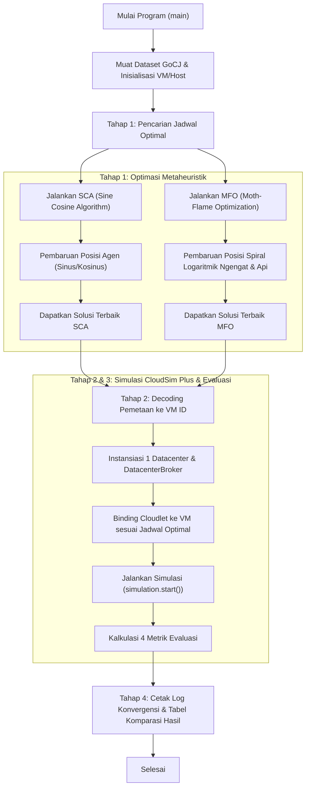

# Penjadwalan Tugas Komputasi Awan Berbasis Metaheuristik (SCA vs MFO) pada CloudSim Plus

Proyek ini merupakan implementasi dan analisis komparasi penjadwalan tugas (*task scheduling*) pada lingkungan komputasi awan (*cloud computing*) menggunakan dua algoritma metaheuristik modern: **Sine Cosine Algorithm (SCA)** dan **Moth-Flame Optimization (MFO)**. Simulasi dieksekusi secara realistis menggunakan framework **CloudSim Plus v7.3.0** dengan dataset benchmark **Google Cloud Jobs (GoCJ)**.

---

## Anggota Kelompok

Proyek ini disusun untuk memenuhi tugas mata kuliah **Strategi Optimasi Komputasi Awan (SOKA)** - Institut Teknologi Sepuluh Nopember (ITS).

| No | Nama Lengkap | NRP |
|:--:|:---|:---:|
| 1 | Putu Yudi Nandanjaya Wiraguna | 5027241080 |
| 2 | Danuja Prasasta Bastu | 5027241037 |
| 3 | Muhammad Huda Rabbani | 5027241098 |
| 4 | I Gede Bagus Saka Sinatrya | 5027241088 |
| 5 | Raynard Carlent | 5027241109 |

---

## Latar Belakang & Masalah

Penjadwalan tugas (*cloud task scheduling*) merupakan masalah optimasi kombinatorial berstatus **NP-hard**. Pada lingkungan komputasi awan heterogen, setiap *Virtual Machine* (VM) memiliki kapasitas komputasi (MIPS) yang berbeda-beda, dan setiap *Cloudlet* (tugas) memiliki panjang instruksi (*length/MI*) yang bervariasi.

Tujuan utama dari optimasi penjadwalan ini adalah:
1. **Meminimalkan Makespan**: Mempercepat waktu penyelesaian akhir dari seluruh tugas pada VM yang paling lambat.
2. **Memaksimalkan Utilisasi Sumber Daya (*Resource Utilization*)**: Memastikan seluruh VM bekerja optimal tanpa ada yang *idle*.
3. **Pemerataan Beban (*Load Balancing*)**: Mengurangi deviasi standar beban kerja di antara seluruh VM agar tidak terjadi *bottleneck*.
4. **Efisiensi Energi (*Energy Consumption*)**: Mengurangi konsumsi daya listrik (kWh) pada datacenter fisik.

---

## Model Simulasi & Spesifikasi Infrastruktur Cloud

Simulasi dibangun menggunakan framework **CloudSim Plus** dengan hierarki infrastruktur sebagai berikut:

### 1. Datacenter & Physical Hosts
- **Jumlah Datacenter:** **1 Datacenter** (`DatacenterSimple`) yang mengelola seluruh infrastruktur fisik dan komputasi awan.
- **Jumlah Host Fisik:** **4 Host** di dalam Datacenter tersebut.
- **Processing Elements (PE):** 2 Core per Host (masing-masing 10.000 MIPS, total 20.000 MIPS per Host).
- **RAM Fisik:** 16.384 MB (16 GB) per Host.
- **Storage Fisik:** 1.000.000 MB (1 TB) per Host.
- **Bandwidth Jaringan:** 10.000 Mbps.
- **VM Scheduler:** `VmSchedulerTimeShared` (pembagian waktu CPU host antar VM).
- **Model Konsumsi Daya Listrik:**
  - Daya Maksimal ($P_{max}$): 250 Watt per Host.
  - Daya Saat Menganggur ($P_{idle}$): $60\% \times P_{max} = 150\text{ Watt}$.

### 2. Virtual Machines (Heterogen)
Terdapat **8 VM** yang berjalan di dalam Datacenter dengan konfigurasi heterogen untuk merepresentasikan variasi mesin di lingkungan komputasi awan nyata:

| VM ID | MIPS (Kapasitas CPU) | RAM (MB) | Bandwidth (Mbps) | Storage (MB) | Cloudlet Scheduler |
|:-----:|:--------------------:|:--------:|:----------------:|:------------:|:-------------------|
| VM 0  | 1000                 | 1024     | 1000             | 10000        | Space-Shared       |
| VM 1  | 1000                 | 1024     | 1000             | 10000        | Space-Shared       |
| VM 2  | 2000                 | 1024     | 1000             | 10000        | Space-Shared       |
| VM 3  | 3000                 | 1024     | 1000             | 10000        | Space-Shared       |
| VM 4  | 2500                 | 1024     | 1000             | 10000        | Space-Shared       |
| VM 5  | 4000                 | 1024     | 1000             | 10000        | Space-Shared       |
| VM 6  | 4000                 | 1024     | 1000             | 10000        | Space-Shared       |
| VM 7  | 4000                 | 1024     | 1000             | 10000        | Space-Shared       |

### 3. Dataset Tugas (Cloudlets)
Dataset yang digunakan adalah benchmark standar **GoCJ (Google Cloud Jobs)** yang disimpan di `src/main/resources/`:
- Tersedia 23 variasi ukuran dataset: mulai dari `GoCJ_Dataset_100.txt` hingga `GoCJ_Dataset_5000.txt` (100, 150, 200, 250, ..., 1000, 2000, 3000, 4000, 5000 tugas).
- Setiap baris mewakili panjang instruksi tugas dalam satuan MI (*Million Instructions*).

---

## Alur Kerja Sistem (System Workflow)

Alur eksekusi program dirancang modular dengan memisahkan tahap pencarian jadwal optimal (optimasi metaheuristik) dan tahap eksekusi simulasi diskrit pada mesin CloudSim Plus:



### Tahapan Alur Kerja:
1. **Inisialisasi Data:** Program membaca dataset GoCJ dari `src/main/resources/` dan membuat daftar objek `CloudletSimple` serta daftar referensi `VmSimple`.
2. **Pencarian Optimasi (SCA & MFO):**
   - Agen/ngengat merepresentasikan solusi pemetaan tugas ke VM dalam ruang kontinu $[0, VM\_COUNT - 1]$.
   - Setiap posisi dievaluasi nilai *fitness*-nya berdasarkan Makespan estimasi.
   - Algoritma SCA dan MFO memperbarui posisi seluruh individu hingga mencapai `MAX_ITERATION` (100 iterasi).
3. **Decoding Solusi:** Vektor posisi kontinu terbaik dibulatkan (*rounding*) menjadi indeks integer diskrit VM ($0$ sampai $7$).
4. **Eksekusi Simulasi CloudSim Plus:**
   - Datacenter (1 buah), 4 Host fisik, dan Broker diinstansiasi.
   - Broker mengikat (*binding*) masing-masing tugas ke VM target yang telah ditentukan oleh hasil optimasi (`broker.bindCloudletToVm`).
   - Mesin simulasi dijalankan secara nyata (`simulation.start()`).
5. **Evaluasi & Komparasi:** Mengambil data hasil eksekusi tugas, menghitung 4 metrik performa, dan mencetak perbandingan kinerja SCA vs MFO beserta konvergensinya.

---

## Algoritma Metaheuristik yang Digunakan

### 1. Sine Cosine Algorithm (SCA)
Dikembangkan oleh Seyedali Mirjalili (2016), SCA memanfaatkan sifat matematis osilasi fungsi trigonometri sinus ($\sin$) dan kosinus ($\cos$) untuk melakukan eksplorasi (*exploration*) dan eksploitasi (*exploitation*) pada ruang pencarian solusi.

#### a. Persamaan Pembaruan Posisi Agen
Pada setiap iterasi $t$, posisi agen ke-$i$ pada dimensi ke-$d$ diperbarui menggunakan persamaan matematis:

$$
X_{i,d}^{t+1} = \begin{cases} 
X_{i,d}^t + r_1 \cdot \sin(r_2) \cdot \left| r_3 \cdot P_d^t - X_{i,d}^t \right|, & \text{jika } r_4 < 0.5 \\[12pt]
X_{i,d}^t + r_1 \cdot \cos(r_2) \cdot \left| r_3 \cdot P_d^t - X_{i,d}^t \right|, & \text{jika } r_4 \ge 0.5 
\end{cases}
$$

di mana $P_d^t$ adalah posisi terbaik (*best destination point*) pada dimensi $d$ yang telah ditemukan oleh populasi hingga iterasi $t$.

#### b. Persamaan Parameter Adaptif ($r_1$)
Untuk memastikan terjadinya transisi yang mulus dari tahap eksplorasi global ke tahap eksploitasi lokal, parameter $r_1$ diturunkan secara linear terhadap iterasi:

$$
r_1 = a - t \cdot \left(\frac{a}{T}\right)
$$

dengan nilai konstanta $a = 2$, $t$ adalah iterasi saat ini, dan $T$ adalah iterasi maksimum (`MAX_ITERATION = 100`).

#### c. Rincian Peran Parameter SCA
| Parameter | Nilai / Rentang | Peran & Pengaruh Matematis |
|:---:|:---:|:---|
| **$r_1$** | $2 \to 0$ (Linear) | **Menentukan radius area pencarian**: Mengarahkan perpindahan agen menuju ruang antara agen dan target tujuan ($r_1 \le 1$, eksploitasi) atau di luar target tujuan ($r_1 > 1$, eksplorasi). |
| **$r_2$** | $[0, 2\pi]$ | **Menentukan arah & jarak**: Menentukan seberapa jauh pergerakan agen harus menuju atau menjauhi posisi terbaik tujuan. |
| **$r_3$** | $[0, 2]$ | **Bobot stokastik target ($P_d^t$)**: Memberikan efek acak untuk memperkuat ($r_3 > 1$) atau mengurangi ($r_3 < 1$) pengaruh posisi target terbaik. |
| **$r_4$** | $[0, 1]$ | **Saklar transisi (*switching mechanism*)**: Mengontrol pergantian probabilistik antara penggunaan fungsi sinus ($r_4 < 0.5$) dan kosinus ($r_4 \ge 0.5$). |

---

### 2. Moth-Flame Optimization (MFO)
Dikembangkan oleh Seyedali Mirjalili (2015), MFO mengemulasikan mekanisme navigasi melintang (*transverse orientation*) ngengat (*moths*) di alam bebas yang mempertahankan sudut konstan terhadap sumber cahaya/api (*flames*).

#### a. Persamaan Pergerakan Spiral Logaritmik
Setiap ngengat memperbarui posisinya terhadap api (*flame*) target menggunakan model spiral logaritmik:

$$
M_{i,d}^{t+1} = D_i \cdot e^{b \cdot r} \cdot \cos(2\pi r) + F_{j,d}^t
$$

di mana:
- $D_i = \left| F_{j,d}^t - M_{i,d}^t \right|$ merepresentasikan jarak linier antara ngengat ke-$i$ dengan api ke-$j$.
- $b = 1$ adalah konstanta yang mendefinisikan bentuk spiral logaritmik.
- $r \in [a, 1]$ adalah bilangan acak yang menentukan kedekatan posisi berikutnya terhadap api ($r = -1$ adalah titik terdekat ke api, $r = 1$ adalah titik terjauh).
- $F_{j,d}^t$ adalah posisi api ke-$j$ pada dimensi ke-$d$.

#### b. Persamaan Penurunan Adaptif Parameter Spiral ($a$)
Parameter $a$ diturunkan secara linear dari $-1$ menuju $-2$ untuk mempercepat konvergensi di sekitar api:

$$
a = -1 + t \cdot \left(\frac{-1}{T}\right)
$$

#### c. Persamaan Pengurangan Jumlah Api Adaptif (*Adaptive Flame Reduction*)
Untuk menghindari konvergensi prematur (*stagnation*) pada optimum lokal dan menyeimbangkan eksplorasi dengan eksploitasi, jumlah api yang aktif dikurangi secara dinamis sepanjang iterasi:

$$
Flame\_No = \text{round}\left(N - t \cdot \left(\frac{N - 1}{T}\right)\right)
$$

dengan $N$ adalah ukuran populasi awal (`POPULATION_SIZE = 30`), $t$ adalah iterasi saat ini, dan $T$ adalah iterasi maksimum (`MAX_ITERATION = 100`). Pada iterasi akhir, seluruh ngengat hanya memperbarui posisi terhadap api terbaik pertama.

---

## 4 Metrik Evaluasi Kinerja

1. **Makespan (Detik)**  
   Waktu penyelesaian akhir dari seluruh tugas (*completion time* maksimum):
   $$
   Makespan = \max_{j \in \{0, \dots, VM-1\}} Load(VM_j)
   $$
   *(Semakin rendah nilainya, semakin baik performa penjadwalan)*

2. **Resource Utilization (%)**  
   Tingkat pemanfaatan rata-rata seluruh mesin terhadap Makespan:
   $$
   Utilization = \left(\frac{\overline{Load}}{Makespan}\right) \times 100\%
   $$
   di mana $\overline{Load} = \frac{1}{m} \sum_{j=0}^{m-1} Load(VM_j)$.  
   *(Semakin tinggi persentasenya, semakin efisien utilisasi sumber daya)*

3. **Load Balancing (Standard Deviation)**  
   Penyebaran beban eksekusi di antara seluruh VM untuk mengukur keseimbangan beban:
   $$
   \sigma = \sqrt{\frac{1}{m} \sum_{j=0}^{m-1} \left(Load(VM_j) - \overline{Load}\right)^2}
   $$
   *(Semakin rendah nilainya, semakin merata pembagian beban antar VM)*

4. **Konsumsi Energi Datacenter (kWh)**  
   Estimasi konsumsi daya fisik berdasarkan model linier utilisasi:
   $$
   P_{host} = P_{idle} + (P_{max} - P_{idle}) \times \left(\frac{Utilization}{100}\right)
   $$
   $$
   Energy = \frac{HostCount \times P_{host} \times Makespan}{3.600.000} \text{ kWh}
   $$
   *(Semakin rendah nilainya, semakin hemat konsumsi energi datacenter)*

---

## Source Code & Implementasi

Seluruh implementasi proyek ini terpusat pada file [SokaCloudSimRunner.java](src/main/java/org/example/SokaCloudSimRunner.java) dengan struktur modul yang sangat terorganisir:

### 1. Konstanta & Parameter Konfigurasi
Terletak pada baris 32–42:
- `DATASET_FILE`: Menentukan nama file dataset yang akan diuji dari folder `resources`.
- `HOST_COUNT` (4): Jumlah Host fisik di Datacenter.
- `HOST_MAX_POWER_WATT` (250.0): Daya maksimum per host.
- `VM_COUNT` (8): Jumlah Virtual Machines heterogen.
- `POPULATION_SIZE` (30): Jumlah agen/ngengat dalam populasi metaheuristik ($N$).
- `MAX_ITERATION` (100): Jumlah iterasi maksimum algoritma ($T$).

### 2. Fungsi Utama (`main`)
- Memuat VM referensi dan Cloudlets dari dataset.
- Menjalankan fungsi `runSCA(...)` dan `runMFO(...)` untuk mendapatkan pemetaan optimal.
- Menjalankan simulasi nyata melalui `runCloudSimWithMapping(...)`.
- Mencetak log konvergensi per 20 iterasi dan tabel perbandingan 4 metrik performa di akhir eksekusi.

### 3. Pemuatan Dataset (`loadCloudletsFromDataset`)
- Menggunakan `ClassLoader.getResourceAsStream()` untuk membaca file dataset GoCJ dari `src/main/resources/`.
- Membaca baris demi baris, mengonversi nilai menjadi panjang instruksi tugas (`length`), dan membuat objek `CloudletSimple`.
- Mengatur ukuran file input/output sebesar 300 byte dan model utilisasi penuh (`UtilizationModelFull`).

### 4. Pembangun Infrastruktur Datacenter & VM
- `createDatacenter(CloudSim simulation)`:
  - Menginstansiasi **1 Datacenter** (`DatacenterSimple`).
  - Mengonfigurasi 4 Host (`HostSimple`), masing-masing dengan 2 PE (10.000 MIPS per PE), RAM 16 GB, Storage 1 TB, Bandwidth 10 Gbps, dan scheduler `VmSchedulerTimeShared`.
- `createVms()`:
  - Menginstansiasi 8 VM heterogen (`VmSimple`) dengan array MIPS: `{1000, 1000, 2000, 3000, 2500, 4000, 4000, 4000}`.
  - Setiap VM menggunakan scheduler `CloudletSchedulerSpaceShared`.

### 5. Algoritma Optimasi Metaheuristik
- `runSCA(List<Cloudlet> cloudlets, List<Vm> vms)`:
  - Menginisialisasi populasi agen berdimensi $D$ (sejumlah Cloudlets).
  - Melakukan looping hingga 100 iterasi.
  - Memperbarui parameter adaptif $r_1$, nilai stokastik $r_2, r_3, r_4$, serta posisi agen berbasis fungsi sinus dan kosinus.
  - Menyimpan posisi terbaik global (*globalBest*).
- `runMFO(List<Cloudlet> cloudlets, List<Vm> vms)`:
  - Menginisialisasi populasi ngengat dan daftar api (*flames*).
  - Mengurutkan fitness ngengat dan api.
  - Menghitung penurunan jumlah api secara adaptif (`flameNo`).
  - Memperbarui posisi ngengat berdasarkan rumus spiral logaritmik terhadap api target.

### 6. Decoding & Evaluasi Kebugaran (*Fitness*)
- `decodeToVmIndex(double continuousValue, int vmCount)`:
  - Mengonversi nilai float/double posisi agen menjadi integer indeks VM menggunakan `Math.round()`, dengan batas aman $[0, \text{vmCount} - 1]$.
- `evaluatePosition(double[] position, ...)`:
  - Menghitung akumulasi waktu eksekusi tugas pada masing-masing VM:
    $$ExecTime = \frac{\text{Cloudlet Length}}{\text{VM MIPS}}$$
  - Mengembalikan objek `MetricsResult` dengan Makespan sebagai nilai fitness utama.
- `computeMetricsFromLoads(double[] vmLoads)`:
  - Menghitung Makespan, rata-rata beban (*average load*), persentase utilisasi, standar deviasi (*load balancing*), dan estimasi konsumsi energi (kWh).

### 7. Eksekusi Simulasi CloudSim Plus (`runCloudSimWithMapping`)
- Membuat instansiasi `CloudSim`, `Datacenter`, dan `DatacenterBrokerSimple`.
- Mendaftarkan daftar VM dan daftar Cloudlet ke Broker.
- Melakukan pemetaan definitif menggunakan `broker.bindCloudletToVm(cloudlet, vm)` berdasarkan jadwal terbaik hasil optimasi.
- Memulai simulasi dengan `simulation.start()`.
- Mengambil daftar tugas yang selesai dieksekusi (`broker.getCloudletFinishedList()`) dan mencetak tabel eksekusi jika diminta (`CloudletsTableBuilder`).

### 8. Inner Classes (Struktur Data Pendukung)
- `Agent`: Representasi individu solusi yang menyimpan array posisi `double[] position` dan `double fitness`. Mengimplementasikan `Comparable<Agent>` untuk mempermudah sorting pada algoritma MFO.
- `OptimizationResult`: Kontainer yang menyimpan vektor posisi terbaik dan riwayat log konvergensi per iterasi.
- `MetricsResult`: Kontainer untuk menyimpan 4 metrik evaluasi (makespan, utilization, stdDev, energyKwh).
- `SimulationOutput`: Kontainer penyimpan daftar tugas selesai dan objek `MetricsResult`.

---

## Struktur Direktori

```text
Metaheuristik-SCA-MFO/
├── .idea/                           # Konfigurasi IDE IntelliJ
├── src/
│   └── main/
│       ├── java/
│       │   └── org/
│       │       └── example/
│       │           └── SokaCloudSimRunner.java   # Source code utama (SCA, MFO, CloudSim Plus)
│       └── resources/
│           ├── GoCJ_Dataset_100.txt              # Dataset benchmark 100 cloudlets
│           ├── GoCJ_Dataset_150.txt
│           ├── ...
│           └── GoCJ_Dataset_5000.txt             # Dataset benchmark 5000 cloudlets
├── pom.xml                                      # Konfigurasi Maven & dependensi CloudSim Plus
└── README.md                                    # Dokumentasi komprehensif proyek
```

---

## Panduan Menjalankan Proyek

### Prasyarat
- **Java Development Kit (JDK):** Versi 17 atau lebih baru (direkomendasikan JDK 17 atau JDK 21).
- **Apache Maven:** Versi 3.6+ (jika menjalankan melalui CLI).
- **IDE (Opsional):** IntelliJ IDEA, Eclipse, atau Visual Studio Code.

---

### Cara 1: Menggunakan Maven CLI (Terminal / PowerShell / Command Prompt)

1. Pastikan Anda berada pada direktori *root* proyek:
   ```bash
   cd Metaheuristik-SCA-MFO
   ```

2. Jalankan perintah kompilasi dan eksekusi:
   ```bash
   mvn compile exec:java "-Dexec.mainClass=org.example.SokaCloudSimRunner"
   ```

---

### Cara 2: Menggunakan IntelliJ IDEA

1. Buka folder proyek ini di **IntelliJ IDEA** (`File` -> `Open...`).
2. Tunggu proses sinkronisasi Maven selesai mengunduh dependensi `cloudsim-plus`.
3. Buka file `src/main/java/org/example/SokaCloudSimRunner.java`.
4. Klik tombol panah hijau **Run ▶** di sebelah method `public static void main(String[] args)` atau tekan shortcut **`Shift + F10`**.

---

### Cara 3: Menggunakan Visual Studio Code

1. Buka folder proyek di VS Code.
2. Pastikan ekstensi **Extension Pack for Java** telah terinstal.
3. Buka file `SokaCloudSimRunner.java` dan klik tombol **Run** yang muncul di atas method `main`.

---

## Konfigurasi Eksperimen

Anda dapat menyesuaikan parameter eksperimen dengan mengubah konstanta pada baris awal class `SokaCloudSimRunner.java`:

```java
// Pilih dataset dari folder src/main/resources/
private static final String DATASET_FILE = "GoCJ_Dataset_100.txt";

// Parameter Infrastruktur
private static final int HOST_COUNT = 4;
private static final double HOST_MAX_POWER_WATT = 250.0;
private static final int VM_COUNT = 8;

// Parameter Metaheuristik
private static final int POPULATION_SIZE = 30; // Ukuran Populasi (N)
private static final int MAX_ITERATION = 100;  // Iterasi Maksimum (T)
```

---

## Contoh Hasil Output Simulasi

Berikut adalah contoh luaran hasil eksekusi program perbandingan algoritma pada dataset 100 cloudlets:

```text
=================================================================
  SIMULASI SOKA (CloudSim Plus): PERBANDINGAN SCA VS MFO
  Dataset: GoCJ_Dataset_100.txt (100 Cloudlets)
=================================================================

=================================================================
  PROGRES KONVERGENSI ALGORITMA (100 Iterasi)
=================================================================
[1] Sine Cosine Algorithm (SCA - Mirjalili, 2016):
  Iterasi   1 -> Best Makespan SCA: 1236.75 detik
  Iterasi  20 -> Best Makespan SCA: 1236.75 detik
  Iterasi  40 -> Best Makespan SCA: 1236.75 detik
  Iterasi  60 -> Best Makespan SCA: 1236.75 detik
  Iterasi  80 -> Best Makespan SCA: 1199.60 detik
  Iterasi 100 -> Best Makespan SCA: 1067.50 detik

[2] Moth-Flame Optimization (MFO - Mirjalili, 2015):
  Iterasi   1 -> Best Makespan MFO: 948.33 detik
  Iterasi  20 -> Best Makespan MFO: 770.00 detik
  Iterasi  40 -> Best Makespan MFO: 754.63 detik
  Iterasi  60 -> Best Makespan MFO: 818.75 detik
  Iterasi  80 -> Best Makespan MFO: 772.75 detik
  Iterasi 100 -> Best Makespan MFO: 762.75 detik

=================================================================
  HASIL EVALUASI KOMPARASI (SCA vs MFO)
=================================================================
Metrik Evaluasi              | SCA            | MFO           
-----------------------------------------------------------------
Makespan (Detik) [v]         | 1067.50 s      | 762.75 s      
Resource Utilization [^]     | 69.93 %        | 82.31 %       
Load Balancing (StdDev) [v]  | 323.17         | 138.44        
Konsumsi Energi (kWh) [v]    | 0.26087 kWh    | 0.19688 kWh   
=================================================================
KESIMPULAN: MFO lebih optimal dengan selisih Makespan 304.75 detik.
```

---

## Referensi

1. **Mirjalili, S. (2015).** *Moth-flame optimization algorithm: A novel nature-inspired heuristic paradigm.* Knowledge-Based Systems, 89, 228–249.
2. **Mirjalili, S. (2016).** *SCA: A Sine Cosine Algorithm for solving optimization problems.* Knowledge-Based Systems, 96, 120–133.
3. **Silva Filho, M. C., et al. (2017).** *CloudSim Plus: a cloud computing simulation framework pursuing software engineering principles for improved modularity, extensibility and correctness.* IFIP/IEEE Symposium on Integrated Network and Service Management.
